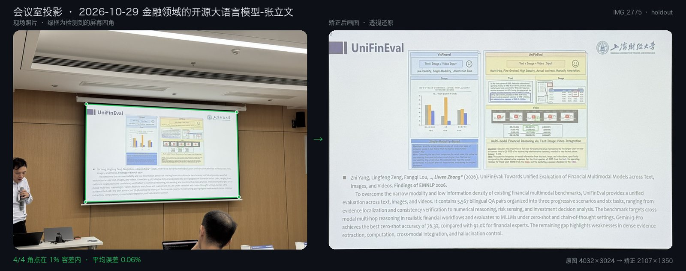
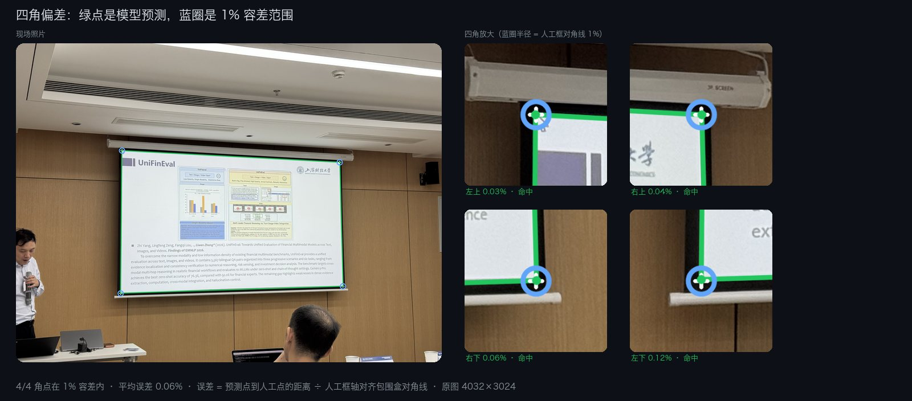
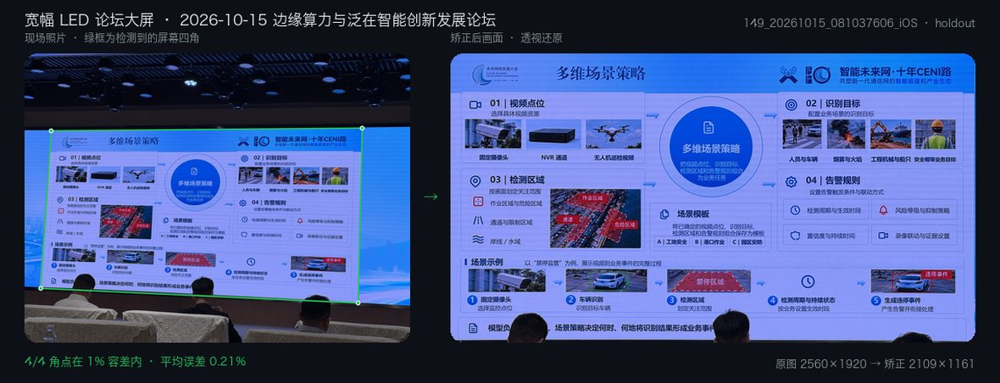
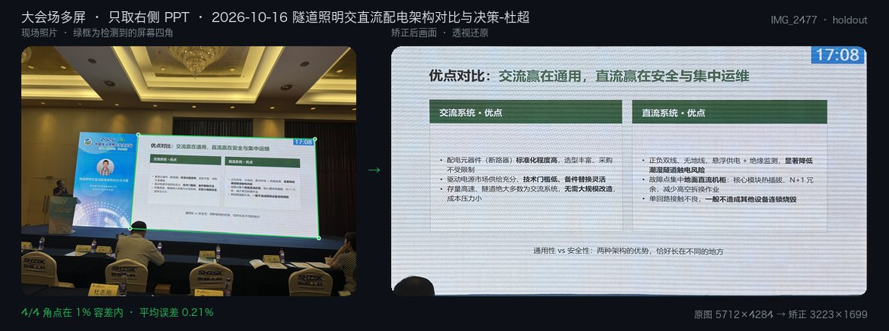
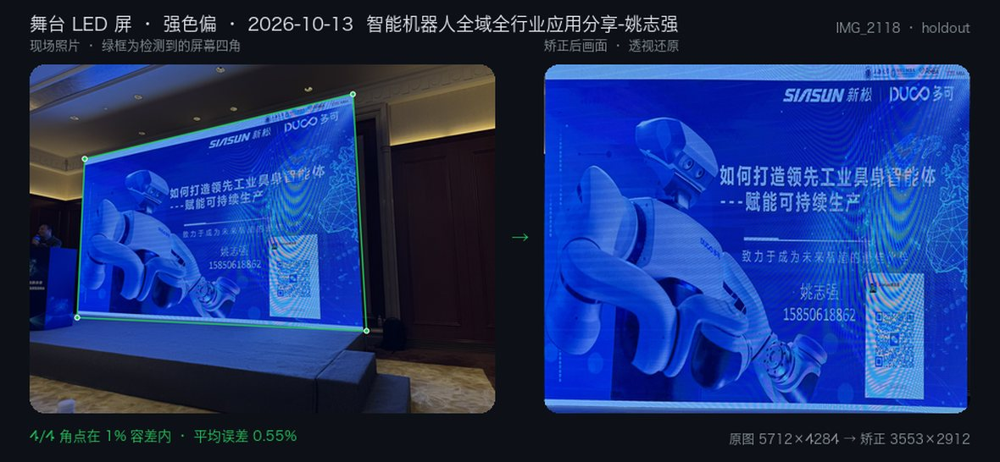
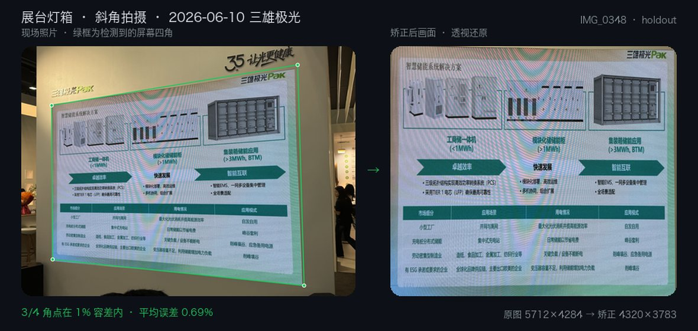
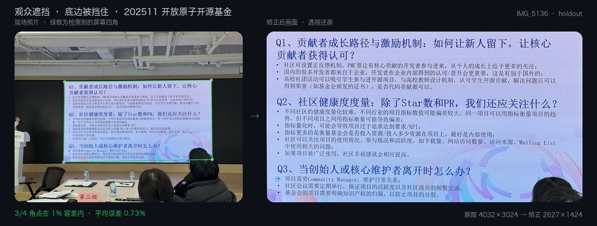
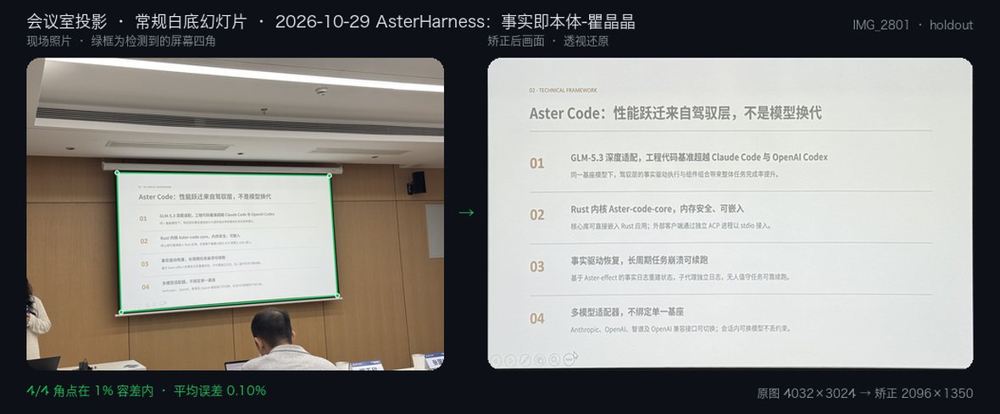
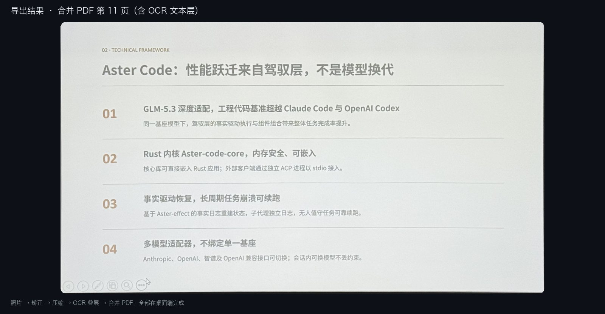
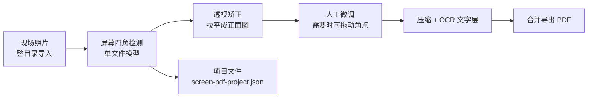

# ScreenPDF

**把会场上拍下来的投影照片，自动矫正成干净、可搜索的 PDF。**

拍歪、带透视、被观众挡住的屏幕，程序会自己找到屏幕四角、拉平成正面图，再压缩、加 OCR 文字层、合并导出成一个 PDF。检测模型跑在本地，离线可用。

macOS · Windows · Linux ｜ 单文件本地模型 `screen_corner_single_9db7ad220b21` ｜ 桌面版本 0.2.28



*绿框是模型自动找到的屏幕四角，右侧是透视还原后的画面，全程没有手动拉点。*

## 目录

- [效果](#效果)
- [工作流程](#工作流程)
- [功能](#功能)
- [下载与安装](#下载与安装)
- [快速开始](#快速开始)
- [当前模型与精度](#当前模型与精度)
- [打包与发布](#打包与发布)
- [仓库结构](#仓库结构)
- [文档](#文档)
- [最近更新](#最近更新)

## 效果

### 准到什么程度

准确率只有一个口径：`point_le_0_01_ratio`，即角点误差不超过人工框对角线 **1%** 的角点占比。下图把这条 1% 容差画了出来——蓝圈半径就是 1%，绿点是模型输出。



### 更多现场（已查看回归页面）

下面都取自各场景的 holdout 页面，按命中情况挑选，**不代表平均精度**，平均指标见[当前模型与精度](#当前模型与精度)。

| 现场照片 → 矫正后画面 | 现场照片 → 矫正后画面 |
|:---:|:---:|
|  |  |
|  |  |
|  |  |

### 导出结果



## 工作流程



一个模型文件里同时完成全局定位、局部取样与四角精修，运行时不依赖其它权重文件。

## 功能

- **自动四角检测**：会议室投影、宽幅 LED 舞台屏、展台灯箱、被观众头部遮挡的底边都能处理。
- **人工兜底**：任何一页都可以手动拖动四角，检测只是起点。
- **整场批处理**：选中一个目录即可扫描整场演讲的照片，按拍摄时间排序成组。
- **项目文件**：根目录唯一 `screen-pdf-project.json`、相对路径、按当前目录名导出，移动目录不丢状态。
- **PDF 导出**：先合并出原始 PDF（`merged-raw.pdf`），再用 ghostscript 压出 `merged-optimized.pdf`；文字层语言默认 `chi_sim+eng`，可搜索可选。
- **全本地**：模型、OCR、PDF 全在本机跑，不需要联网。

## 下载与安装

桌面安装包发布在 [GitHub Releases](https://github.com/GcsSloop/screen-pdf/releases)。

仓库里的 `release-assets/` 是本地打包产物目录（不进版本库）；本地 ad-hoc 签名、未公证，仅用于自测分发。

## 快速开始

### 桌面程序

```bash
cd program/desktop
pnpm install
pnpm tauri dev
```

### Python 引擎

```bash
PYTHONPATH=program/engine python3 program/engine/detect_frame.py --help
```

运行时模型默认从 `models/runtime/` 读取，可用环境变量覆盖：

```bash
export SCREEN_PDF_MODEL_DIR=/absolute/path/to/models/runtime
export SCREEN_PDF_SINGLE_MODEL=/absolute/path/to/screen_corner_single.pt
```

## 当前模型与精度

正式 runtime 为 [models/runtime/screen_corner_single.pt](models/runtime/screen_corner_single.pt)，模型标识 `screen_corner_single_9db7ad220b21`，发布编号 `model-20261029-180536-9db7ad220b21`，对应桌面版本 0.2.28。

| 集合 | 命中 / 角点 | 说明 |
| --- | --- | --- |
| 冻结 1808 页诊断 | 6881 / 7232（95.1%） | 13 个会议集合，含训练页，仅作覆盖与拟合诊断 |
| 483 页开发验证 | 1688 / 1932 | 选模型唯一依据 |
| 266 页已查看回归 | 936 / 1064 | 已查看，不是盲测 |

- 口径、平局规则与分母定义见 [评估契约](docs/status/evaluation-contract.md)。
- 模型来自单 seed、固定预算对照；标注中有一部分由当前 runtime 候选微调后再人工修正（`runtime_candidate_seeded_manual`），不是独立人工真值。
- 残余失败仍存在，例如隅角被遮挡、远景上角误吸吊顶；逐页结果写在 [当前状态](docs/status/current-status.md)。

## 打包与发布

```bash
make package-desktop            # 当前平台
make package-desktop-macos
make package-desktop-linux
```

打包脚本会准备平台运行时（自带 Python、`tesseract`、`ghostscript`、`models/runtime`），构建 Tauri 应用，把产物收集到 `release-assets/<version>/<platform>/`，并在 macOS 上校验签名、权重摘要与真实检测。完整步骤、验收清单与发布方式见 [桌面程序打包流程](docs/runbooks/desktop-packaging.md)。

版本分流：程序版本用 `v*` tag 触发多平台打包，模型发布用 `model-*` tag 只发元数据。桌面端自动更新读取 Release 里的 `latest.json`。

## 仓库结构

| 路径 | 内容 |
| --- | --- |
| `program/desktop` | Tauri + Vite 桌面程序（编辑界面、项目文件、导出） |
| `program/engine` | Python 检测、OCR、导出、训练与评估 |
| `models/runtime` | 正式运行时模型 |
| `data` | 原始数据、清洗数据、拆分、场景与会议集合（本地资产，不进版本库） |
| `training` | 训练配置、runs、checkpoint、报告与模型注册（本地资产） |
| `research/experiments` | 历史实验、评估报告与对比产物（本地资产） |
| `docs` | 架构、运行手册、当前状态与评估契约 |
| `scripts` | 打包、发布、文档与训练辅助脚本 |

## 文档

1. [当前状态](docs/status/current-status.md)：正式模型、最近一轮训练与安装包验收
2. [评估契约](docs/status/evaluation-contract.md) 与 [当前指标](docs/status/key-metrics.md)
3. [会议场次集合与基准](docs/status/conference-collections.md)
4. [数据集索引](docs/status/dataset-index.md)
5. [仓库布局](docs/architecture/repository-layout.md)
6. [桌面程序打包流程](docs/runbooks/desktop-packaging.md)
7. [模型命名与发布约定](docs/status/model-naming-rules.md)、[模型发布约定](docs/status/model-release-convention.md)
8. [更新日志归档](docs/status/release-history.md)
9. [AGENTS.md](AGENTS.md)：给代理的一页速查

## 最近更新

- **2026-10-30** round_042 精细定位已晋升为正式 runtime，0.2.28 安装包验收完成；两场 12 页开发 42→47/48，冻结 1808 页 6855→6881。
- **2026-10-29** 上海开源大数据创新论坛瞿晶晶 / 徐辉两场共 54 页接入；round_041 张立文场景精修晋升，0.2.27。
- **2026-10-27** 白屏混合 42 页人工四角按用户精修重新登记，round_040 回到正式 runtime（无新候选）。
- **2026-10-25** 中交机电点位重矫正 v2 接入训练快照；开放原子开源基金 6 页作为新场景登记。
- **2026-10-24** round_038 精修晋升（0.2.26）、round_037 四场晋升（0.2.25）、round_036 遮挡定向晋升（0.2.24）。

更早的逐轮记录见 [更新日志归档](docs/status/release-history.md) 与 [当前状态](docs/status/current-status.md)。

## 截图如何生成

`docs/assets/screenshots/` 下的图片全部由脚本生成，正式模型换代后重跑即可：

```bash
make readme-screenshots
# 等价于：program/engine/vendor/macos/bin/python3 scripts/docs/generate_readme_screenshots.py
```

脚本用当前 runtime 在固定的 holdout 页面上推理，绘制四角、矫正结果与 1% 容差圈，并把实测误差写进图注，所以图上的数字和报告里的数字同源。示例页面来自本地 `data/curated/scenes/*/holdout.jsonl`，图片本身不进版本库，只提交渲染结果。

## 说明与局限

- 数据、训练资产与实验产物不进版本库（`data/`、`training/`、`research/` 由 `.gitignore` 排除），克隆仓库后可直接跑程序，但不能直接复现训练。
- 旧三阶段 runtime（`r130 + c22 + r69probe`）保留作兼容；默认检测入口优先加载单文件模型。
- 部分场景仍有整角丢失（强遮挡、屏幕角超出照片范围、远景把吊顶边缘当成屏幕上沿），当前按逐页记录、不回填历史分数处理。
